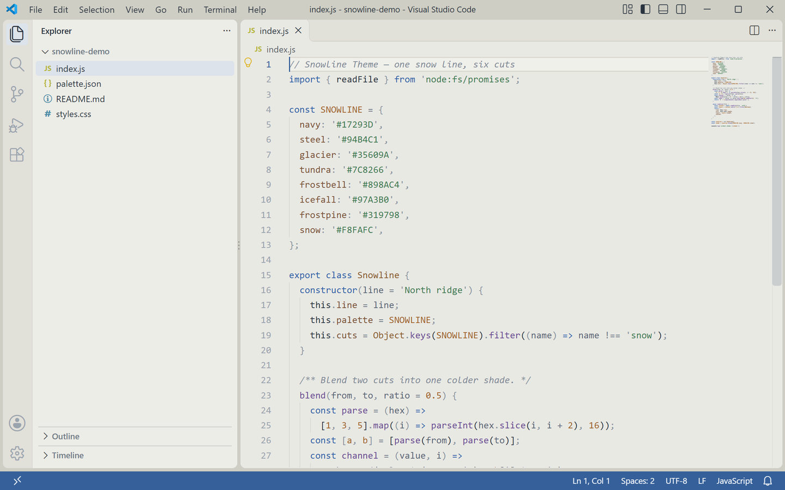
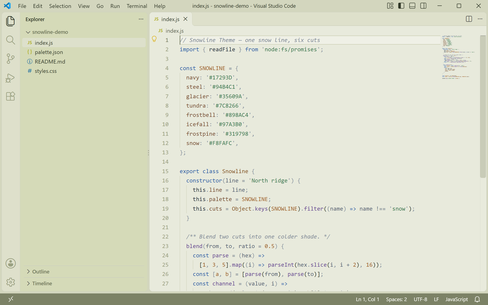
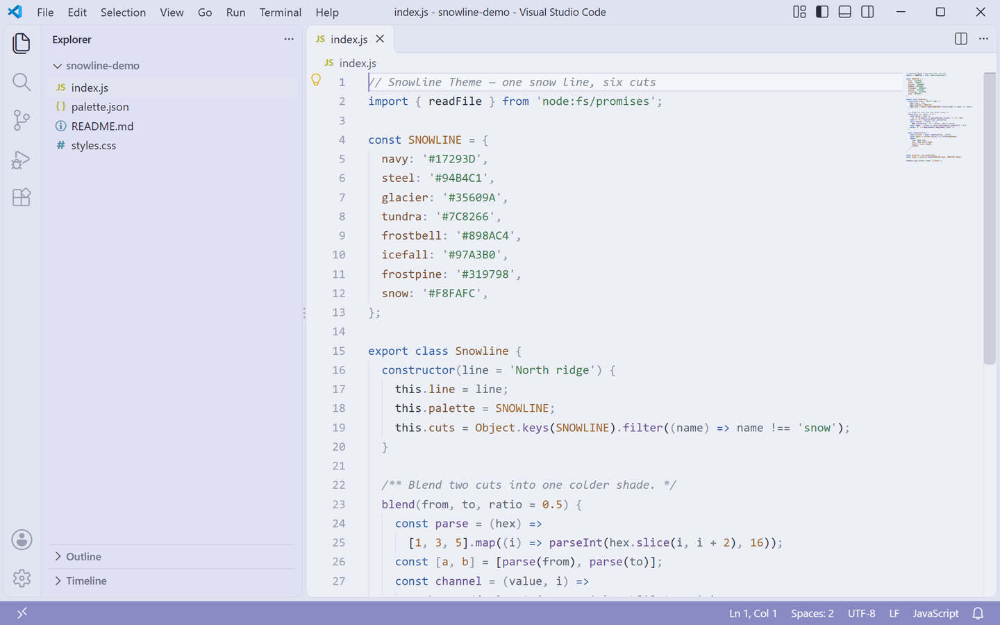
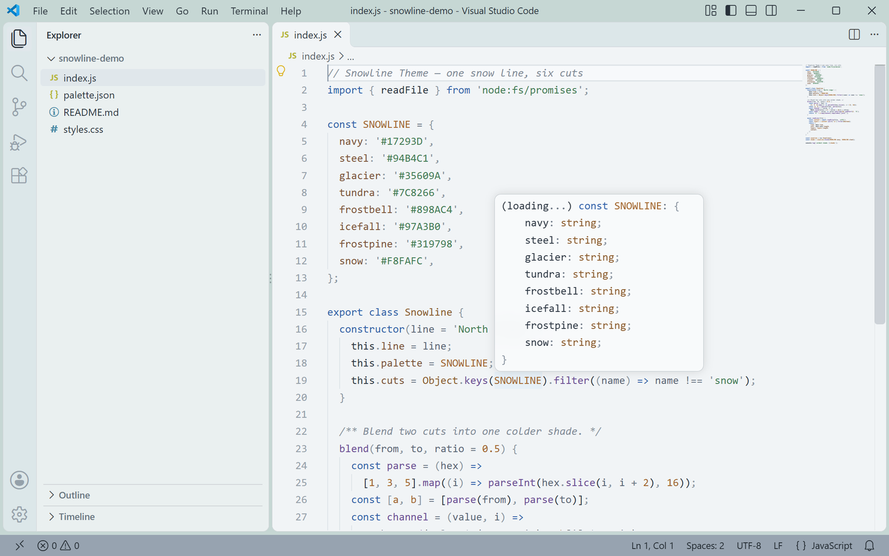
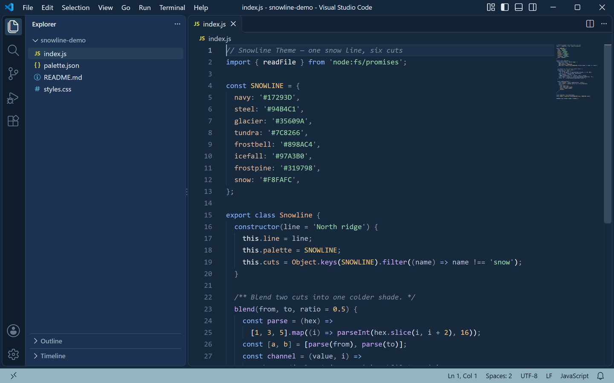
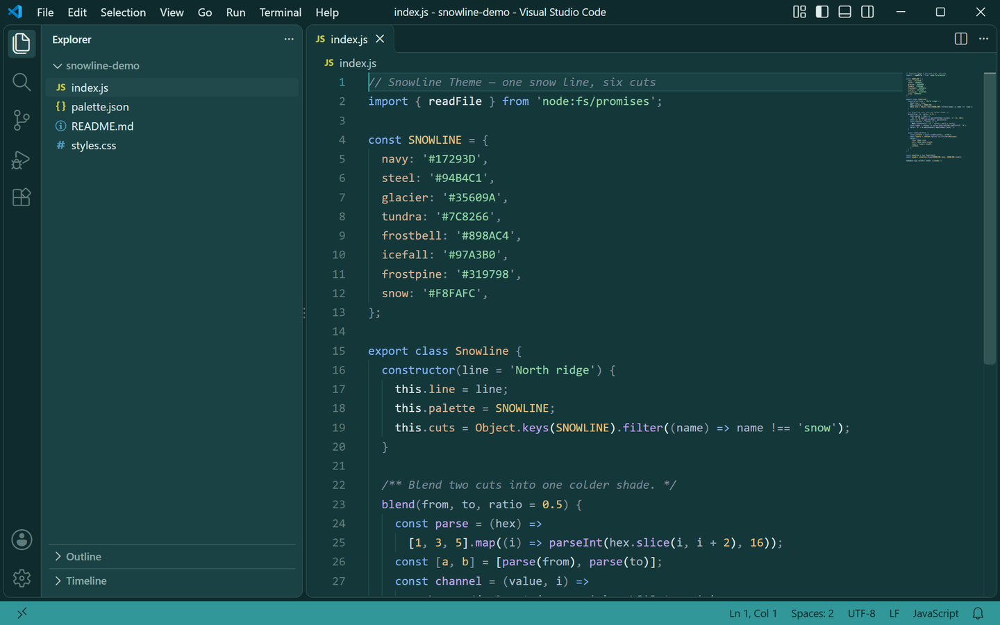

<div align="center">


# Snowline Theme

**One snow line, six winter cuts — Glacier, Tundra, Frostbell, Icefall, Fjord and Frostpine.**

[](https://github.com/vaxicy/snowline-theme)
[](https://code.visualstudio.com/)
[](#six-cuts)
[](LICENSE)
[](https://code.visualstudio.com/)
[](https://github.com/vaxicy/snowline-theme)

[English](#-english) · [简体中文](#-简体中文)

</div>

---

## 🇬🇧 English

**Snowline Theme** puts six cuts of the same winter landscape in one extension. Four are
daylight — paper, sage, violet and ice — and two are night — deep navy and frostpine teal.
They share one syntax palette and one set of chrome rules, so switching between them feels
like walking along a single snow line rather than jumping between themes.

<a id="six-cuts"></a>

### Six cuts

| Cut | Editor | Chrome | Accent | Feel |
|---|---|---|---|---|
| **Glacier** | warm paper `#E9E9E4` | stone `#CFCEC4` | signal blue `#35609A` | neutral, clean |
| **Tundra** | sage paper `#E8EADC` | moss `#D3D6BE` | sage `#7C8266` | dry, quiet, green-grey |
| **Frostbell** | violet paper `#EDEFF7` | periwinkle `#DFE2F0` | violet `#898AC4` | soft, dusky |
| **Icefall** | ice `#F1F4F6` | pale frost `#C6D7D4` | steel `#97A3B0` | cold, high-key |
| **Fjord** | midnight navy `#17293D` | deep navy `#14273C` | pale steel `#94B4C1` | deep, wet, blue |
| **Frostpine** | deep teal `#14383A` | pine `#0F2A2C` | frostpine `#319798` | cold, green-dark |

### Screenshots

Every screenshot is a real VS Code window running the shipped theme.

#### Glacier


#### Tundra


#### Frostbell


#### Icefall


#### Fjord


#### Frostpine


### Install

1. Open **Extensions** in VS Code (`Ctrl+Shift+X`).
2. Search **Snowline Theme** and click **Install**.
3. `Ctrl+K Ctrl+T` → pick **Glacier / Tundra / Frostbell / Icefall / Fjord / Frostpine**.

Or from a VSIX:

```bash
code --install-extension snowline-theme-1.0.0.vsix
```

### Set it in settings.json

```jsonc
{
  "workbench.colorTheme": "Snowline Theme Fjord",

  // optional: keep the cut, move one surface
  "workbench.colorCustomizations": {
    "editor.background": "#1B3247"
  }
}
```

### What's tuned

- **144 hand-placed UI colours** per cut, one shared syntax palette (blue keywords, winter
  green strings, violet functions, ochre numbers) and one set of semantic tokens.
- **De-collided bases.** Every surface was measured against the other themes on the
  marketplace; the nearest neighbour of any cut is at least 0.04 away in HSL distance, and the
  four daylight cuts are separated from each other by temperature — warm paper, sage, violet,
  ice — so the six never read as the same theme with a different tint.
- **One snow line.** The accent of every cut appears in the status bar, the active tab and
  the focus ring, so the six are told apart instantly.

The complete colour table lives in [`COLOR-SPEC.md`](COLOR-SPEC.md).

### Colour cards

**Daylight cuts**

| Swatch | Cut | Hex |
|---|---|---|
| 🧊 | Glacier | `#35609A` |
| 🌾 | Tundra | `#7C8266` |
| 💜 | Frostbell | `#898AC4` |
| 🫧 | Icefall | `#97A3B0` |

**Night cuts**

| Swatch | Cut | Hex |
|---|---|---|
| 🌌 | Fjord | `#94B4C1` |
| 🌲 | Frostpine | `#319798` |
| 🌑 | Midnight navy | `#17293D` |
| ❄️ | Snow | `#F8FAFC` |

---

## 🇨🇳 简体中文

**Snowline Theme** 把同一片冬日风景的六个切面放进了一个扩展：四个白昼（纸灰、苔绿、
长春花、冰白），两个夜晚（深夜藏青、雪松青）。六者共用同一套语法配色和同一套工具栏规则，
切换时像沿着一条雪线走，而不是在主题之间跳来跳去。

### 六个切面

| 切面 | 编辑区 | 工具栏 | 强调色 | 感觉 |
|---|---|---|---|---|
| **Glacier** | 暖纸灰 `#E9E9E4` | 石灰 `#CFCEC4` | 信号蓝 `#35609A` | 中性、干净 |
| **Tundra** | 苔纸 `#E8EADC` | 苔 `#D3D6BE` | 灰绿 `#7C8266` | 干燥、安静、绿灰 |
| **Frostbell** | 紫纸 `#EDEFF7` | 长春花 `#DFE2F0` | 紫 `#898AC4` | 柔和、朦胧 |
| **Icefall** | 冰白 `#F1F4F6` | 霜灰 `#C6D7D4` | 钢灰 `#97A3B0` | 冷、高调 |
| **Fjord** | 深夜藏青 `#17293D` | 深藏青 `#14273C` | 淡钢青 `#94B4C1` | 深、湿润、蓝 |
| **Frostpine** | 深青 `#14383A` | 松青 `#0F2A2C` | 雪松青 `#319798` | 冷、绿调深色 |

### 截图

以下每张都是加载了对应变体的真实 VS Code 窗口。

#### Glacier


#### Tundra


#### Frostbell


#### Icefall


#### Fjord


#### Frostpine


### 安装

1. 在 VS Code 中打开 **扩展**（`Ctrl+Shift+X`）。
2. 搜索 **Snowline Theme** 并点击 **安装**。
3. `Ctrl+K Ctrl+T` → 选择 **Glacier / Tundra / Frostbell / Icefall / Fjord / Frostpine**。

或使用 VSIX 安装：

```bash
code --install-extension snowline-theme-1.0.0.vsix
```

### 在 settings.json 中指定

```jsonc
{
  "workbench.colorTheme": "Snowline Theme Fjord",

  // 可选：保留该切面，只微调一处
  "workbench.colorCustomizations": {
    "editor.background": "#1B3247"
  }
}
```

### 调校细节

- 每个切面 **144 个手工设定的 UI 颜色**，共用一套语法配色（蓝色关键字、冬绿字符串、
  紫色函数、赭黄数字）与一套语义 token。
- **底色避撞**：每一处表面都与市场上其他主题做过实测比对，任一最近邻的 HSL 距离 ≥ 0.04；
  四个白昼切面之间再按色温拉开——暖纸灰 / 苔绿 / 长春花 / 冰白——六个变体不会显得只是换了个色调。
- **一条雪线**：每个切面的强调色都出现在状态栏、活动标签和焦点框上，一眼可辨。

完整配色表见 [`COLOR-SPEC.md`](COLOR-SPEC.md)。

### 色卡

**白昼切面**

| 色块 | 切面 | 色值 |
|---|---|---|
| 🧊 | Glacier | `#35609A` |
| 🌾 | Tundra | `#7C8266` |
| 💜 | Frostbell | `#898AC4` |
| 🫧 | Icefall | `#97A3B0` |

**夜晚切面**

| 色块 | 切面 | 色值 |
|---|---|---|
| 🌌 | Fjord | `#94B4C1` |
| 🌲 | Frostpine | `#319798` |
| 🌑 | 深夜藏青 | `#17293D` |
| ❄️ | 雪白 | `#F8FAFC` |

---

## License

Non-Commercial License — see [LICENSE](LICENSE).
